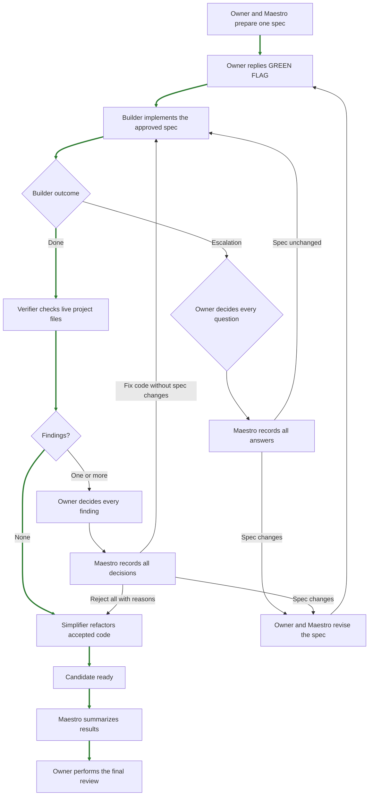

# Workflow

`Maestro` manages one spec-driven workflow in the current Pi session. The `owner` works directly with `Maestro`.

The approved `spec.md` defines behavior, scope, constraints, technical decisions, and `acceptance criteria` for the change.

An `acceptance criterion` contains a coverage label, a `probe`, an `expected result`, and an example. A `probe` is a scenario used to test behavior.

A `handoff` is a saved agent report. `Builder` and `verifier` reports contain `probe` outcomes. The simplifier's report records refactored files, a summary, and notes.

A `builder` `handoff` can contain `escalations`, which are questions that need `owner` decisions. A `verifier` `handoff` can contain `findings`, which are technical
issues.

## Roles

| Role         | Responsibility                                                                                                                                      |
| ------------ | --------------------------------------------------------------------------------------------------------------------------------------------------- |
| `Owner`      | Decides requirements, scope, technical decisions, `spec` approval, `escalation` answers, and `finding` decisions. Performs the final review.        |
| `Maestro`    | Prepares the `spec` with the `owner`, records workflow progress, runs agents, presents issues, and saves `owner` decisions.                         |
| `Builder`    | Implements the approved `spec` and runs every `probe`. Reports completion or an `escalation`, including technical problems that prevent completion. |
| `Verifier`   | Independently runs every `probe` against the live project files. Reports `findings` without repairing product code.                                 |
| `Simplifier` | Refactors accepted code for clarity without changing behavior or introducing check failures.                                                        |

`Builder`, `verifier`, and `simplifier` `runs` are sequential foreground operations. Each starts with a fresh conversation and reads the `spec` and saved `artifacts`.

## Observability

`Observability` is the owner's ability to inspect workflow progress and reported results.

Maestro's Pi status shows the current phase.

`pi-subagents` FleetView and `/subagents-fleet` show live agent activity and transcripts.

Saved `handoffs` provide a structured account of each reported `run`. The `builder` reports its outcome, `probe` results, notes, and any `escalation` questions. The
`verifier` reports its independent checks, results, and `findings`. The `simplifier` reports its refactoring separately. Recorded `owner` decisions explain how questions
and issues were resolved. Earlier numbered reports remain available for inspection.

For example, the `owner` can read `B1.json` to see what the `builder` reports implementing and which `probes` it ran. `V1.json` shows what the `verifier` reports checking
independently and which issues it found.

## Main flow

The green arrows and lines show the path without `escalations` or `findings`.



## Workflow phases

Each `spec` has a `workflow.json` file that records its identity and current phase. The saved phase controls the next permitted workflow action. An agent's final message
alone does not establish a completed action.

The default path is `.specs/<spec-id>/workflow.json`. The `spec` directory is [configurable](configuration.md).

| Phase                  | Meaning                                                                                                                        |
| ---------------------- | ------------------------------------------------------------------------------------------------------------------------------ |
| `drafting-spec`        | The `owner` and `Maestro` prepare the initial `spec` or revise it after recorded `escalation` answers or `finding` decisions.  |
| `ready-for-builder`    | The approved `spec` or recorded `owner` decisions permit a `builder` `run`.                                                    |
| `builder-running`      | A `builder` `run` is active.                                                                                                   |
| `escalation-decisions` | The `owner` must decide how to handle every `escalation` question.                                                             |
| `ready-for-verifier`   | The `builder` completed the work and the `verifier` can start.                                                                 |
| `verifier-running`     | A `verifier` `run` is active.                                                                                                  |
| `finding-decisions`    | The `owner` must decide how to handle every current `finding`.                                                                 |
| `simplifier-running`   | Verification succeeded or the `owner` rejected all current `findings`. The `simplifier` can run or skip if Git is unavailable. |
| `candidate-ready`      | Simplification completed. The workflow is complete.                                                                            |

## Spec approval

For the initial `spec`:

1. `Maestro` creates `spec.md` and `workflow.json` in `drafting-spec` and prepares the `spec` with the `owner`.
2. The `owner` reviews the requirements, scope, technical decisions, and `acceptance criteria`.
3. `Maestro` asks the `owner` to inspect the current `spec.md` and reply `GREEN FLAG` to approve it and start the `builder`.
4. After that reply, `Maestro` saves `ready-for-builder` and starts the `builder` in the foreground.

Approval freezes the `spec`. The `spec` and its visual prototypes remain unchanged during `builder`, `verifier`, and `simplifier` execution. See
[Spec revision](#spec-revision) for permitted revisions.

## Requirement deltas

Each requirement has exactly one `Delta` field. It describes the impact of the requirement against the current system's behavior.

| Value      | Meaning                                                                   |
| ---------- | ------------------------------------------------------------------------- |
| `added`    | Introduces behavior or a constraint that did not exist before the change. |
| `modified` | Changes existing behavior or a constraint.                                |
| `removed`  | Removes behavior that must no longer be available.                        |

The `spec` describes only requirements added, modified, or removed by the change. Existing behavior must continue working unless explicitly changed or removed. Unchanged
behavior is implicit, not an inventory of requirements to repeat in every `spec`.

For `modified` or `removed` requirements, a short `Before` description is included only when it helps explain the change. For example,
`Before: Tokens expire 30 minutes after issuance.`

## Requirement coverage

Each requirement has its own section and a unique, stable ID, such as `REQ1`. Its `Verified by` field links to the `acceptance criteria` or existing tests that verify it.
The mapping appears only under the requirement, not again inside each `acceptance criterion`.

For example, a change that introduces persistent item titles can describe its requirement and linked `acceptance criterion` in `spec.md` as follows:

```markdown
### REQ1: Persist saved titles

Delta: added

Saving and reopening an item must preserve its title.

Verified by: [AC1](#ac1-saved-title-is-preserved)

### AC1: Saved title is persisted

1. Coverage: success
2. Probe: Save a change to an item's title, then reopen the item.
3. Expected result: The saved title is still present.
4. Example: Change the title from "Draft" to "Ready", save, and reopen the item. The title is "Ready".
```

A requirement can link to several `acceptance criteria`, and one criterion can verify several requirements (1:N). When an existing test covers the exact starting
conditions, action, and `expected result`, `Verified by` links to the test file relative to `spec.md` and includes the exact scenario name. No duplicate criterion is
needed. A requirement can reference both criteria and existing tests.

Before approval, `Maestro` follows the links and checks that their combined scenarios verify the whole requirement. Missing, partial, or uncertain coverage must be
resolved with an appropriate criterion or a confirmed existing test. References are updated when criterion headings or test locations change, including during `spec`
revisions.

## Acceptance criteria

Each `acceptance criterion` has a unique ID and describes one observable result.

Each criterion contains these parts:

| Part              | Content                                                                             |
| ----------------- | ----------------------------------------------------------------------------------- |
| Coverage          | One label that states the scenario's purpose: `success`, `failure`, or `unchanged`. |
| `Probe`           | Starting conditions and the action or observation that checks the behavior.         |
| `Expected result` | The measurable result the `probe` observes.                                         |
| Example           | Concrete starting conditions, an input or action, and the exact `expected result`.  |

## Escalations

An `escalation` returns an implementation decision or a technical problem to the `owner`. For instance a technical failure, an undefined behavior, a conflict with the
`spec`, or a possible scope change.

The `builder` saves all questions from one `pass` in the `escalations` list of its numbered `handoff`. `Maestro` identifies each question with both report and
`escalation` IDs, such as `B1/E1`. See [Escalation references](glossary.md#escalation-references) for their scope.

`Maestro` presents each question, evidence, options, consequences, and next steps. The workflow pauses in `escalation-decisions` while the `owner` decides how to proceed.

The `owner` gives `Maestro` an answer and reason for every current question, whether or not the `spec` must change. The `owner` can select a listed option or give a
different decision.

`Maestro` saves all answers in the current `builder` `handoff` before the workflow continues.

| `Owner` choice          | Result                                                                                                                            |
| ----------------------- | --------------------------------------------------------------------------------------------------------------------------------- |
| Keep the current `spec` | `Maestro` starts another `builder` `run` without renewed approval.                                                                |
| Change the `spec`       | The `owner` and `Maestro` revise the same `spec`. The `owner` reviews it and replies `GREEN FLAG` before another `builder` `run`. |

`Owner` decisions update only the questions' `resolution` fields. The handoff's other content and earlier `handoffs` remain unchanged.

## Findings

Every current `finding` requires an `owner` decision, regardless of severity. `Maestro` explains the issue, evidence, practical effect, and available choices.

`Maestro` identifies each `finding` with its report and `finding` IDs. For example, `V1/F2` means `finding` 2 in `verifier` report `V1.json`. The `finding` is an entry in
that file's `findings` list, not a separate `F2.json` file. `Finding` numbers restart at `F1` in each `verifier` report. See
[Finding references](glossary.md#finding-references) for a worked example.

`Maestro` records `owner` decisions in the same `verifier` report, e.g. decisions about `V1/F2` update `V1.json`, not a new `V2.json`. A new `verifier` result creates the
next report (`V2.json`).

| Decision      | Result                                                                                                         |
| ------------- | -------------------------------------------------------------------------------------------------------------- |
| `reject`      | Records the owner's reason. If every `finding` is rejected, the workflow reaches `simplifier-running`.         |
| `fix-code`    | Keeps the current `spec` and returns to `ready-for-builder` for code fixes when no decision requires revision. |
| `revise-spec` | Records the owner's reason and agreed requirement change, then returns to `drafting-spec`.                     |

`Maestro` saves every current decision together before the phase changes. If any `finding` requires revision, revision takes priority over code fixes and rejections. See
[Spec revision](#spec-revision).

Without revision, any `fix-code` decision requires another `builder` `run`, including when other `findings` are rejected. After the `builder` completes the fixes, the
`verifier` checks the work again.

## Spec revision

For either `escalation` answers or `finding` decisions, `Maestro` records the complete batch before the workflow returns to `drafting-spec`. This decision does not
approve the `spec` or start an agent. The `owner` and `Maestro` then revise the same `spec` together in `drafting-spec`.

The `owner` reviews the changes and replies `GREEN FLAG` again. `Maestro` records that renewed approval separately, moves to `ready-for-builder`, and starts another
`builder` `run`. Approval is permitted only in `drafting-spec`, not directly from either decision phase.

The revised `spec` controls subsequent work. Earlier `escalations`, `findings`, and their decisions remain historical context.

## Verification boundary

The `verifier` can make temporary changes for `probes`. Before submitting its `handoff`, it restores the exact original contents of affected files and removes only files
it created.

Cleanup relies on the `verifier`. If cleanup cannot finish safely, the `verifier` stops and reports the remaining changes.

## Simplification

After a successful verification, Maestro starts the `simplifier`. The `simplifier` runs only if Git is available, if not, a warning is displayed:
`Simplifier skipped: Git repository unavailable.`

The `simplifier` starts from all staged, unstaged, and untracked code changes, including pre-existing changes. It preserves observable behavior and introduces no new
check failures. If no code needs refactoring, the `simplifier` does not make any change.

## Workflow completion

The workflow ends at `candidate-ready`. `Maestro` summarizes the changes, verification results, rejected `findings` and reasons, relevant `builder` notes from the saved
`artifacts`, and simplifier's summary and notes

The `owner` performs the final review and controls any later Git use, pull request, or merge. Changes after completion are outside the completed verification.

## Stored artifacts

An `artifact` is a saved workflow file. `Maestro` creates the `spec` directory with `spec.md`, `workflow.json`, and an empty `prototypes/` directory. `Builder`,
`verifier`, and `simplifier` `handoff` directories appear when those results are saved.

The agents submit results through `Maestro` tools instead of writing the reports directly. A successful submission saves the result and updates the phase in
`workflow.json` before the agent returns.

`Builder` (`B`) and `verifier` (`V`) numbers count saved `handoffs` within one `spec`. Each sequence starts at 1 and advances independently. Every saved `builder`
outcome, including `escalation`, creates the next `B` report. Revising the same `spec` keeps these sequences. A new `spec` starts new sequences.

`Escalation` (`E`) numbers identify questions within a `builder` `handoff`. They restart at `E1` in each `handoff`.

For example, a repair cycle with successful `builder` results produces these files:

| Step | Action                                                                  | Report saved or updated                                                         |
| ---- | ----------------------------------------------------------------------- | ------------------------------------------------------------------------------- |
| 1    | The `builder` completes the implementation.                             | Creates `handoffs/builder/B1.json`.                                             |
| 2    | The `verifier` checks it and reports `findings`.                        | Creates `handoffs/verifier/V1.json`.                                            |
| 3    | The `owner` decides every `finding` and requests a code fix.            | Updates decisions in the existing `V1.json`.                                    |
| 4    | A new `builder` `run` completes the fixes.                              | Creates `handoffs/builder/B2.json`.                                             |
| 5    | A new `verifier` `run` checks the work again and reports no `findings`. | Creates `handoffs/verifier/V2.json`. The workflow reaches `simplifier-running`. |
| 6    | The `simplifier` completes its refactoring.                             | Creates `handoffs/simplifier/S.json`, then saves `candidate-ready`.             |

If the first `builder` `run` escalates, it creates `B1.json` with its questions. `Owner` answers update `B1.json`. The next saved `builder` result creates `B2.json`.

A `builder` report has `status: done` or `status: escalation`. A `done` report requires every recorded `probe` to pass and an empty `escalations` list. An `escalation`
retains actual `probe` results: `passed`, `failed`, or `not-run`.

Execution errors or missing or invalid saved results stop the workflow. See [Limitations](#limitations).

The default layout after multiple `runs` is:

```text
.specs/<spec-id>/
├── spec.md
├── workflow.json
├── handoffs/
│   ├── builder/
│   │   ├── B1.json
│   │   └── B2.json
│   ├── verifier/
│   │   ├── V1.json
│   │   └── V2.json
│   └── simplifier/
│       └── S.json
└── prototypes/
```

`Maestro` uses the latest saved `builder` and `verifier` `handoffs` as their active results. New results do not replace earlier numbered reports. Earlier reports remain
available as context, not as proof for the current `run`. `Owner` decisions update the active `builder` or `verifier` `handoff` without creating another numbered report.

## Limitations

### No small models

The `owner` must not use small models with a `low` thinking level for this workflow. These combinations cannot reliably follow the workflow rules. One example is
`gpt-luna-6` with `thinking: "low"`.

Moreover, the workflow works well with a defined harness: tests, lint for code rules, anti-slop checks for unwanted patterns, and `AGENTS.md`. `Maestro` does not supply
these project-specific checks.

### No automatic rollback

Launch errors, delegation failures, timeouts, interruptions, cancellations, and missing or invalid `handoffs` stop the workflow without a recovery transition. If a `run`
saves no completed transition, its saved running phase remains unchanged. Partial protocol writes require manual `owner` follow-up. `Maestro` provides no automatic
rollback, repair, or recovery for these errors. The files that remain are available for `owner` inspection.

### No reconciliation

Disabling `Maestro`, restarting Pi, or using `/resume` clears live `Maestro` session state and leaves project files unchanged. `Maestro` starts disabled in a new or
resumed session. Reactivating it does not reconstruct or resume a saved workflow.
