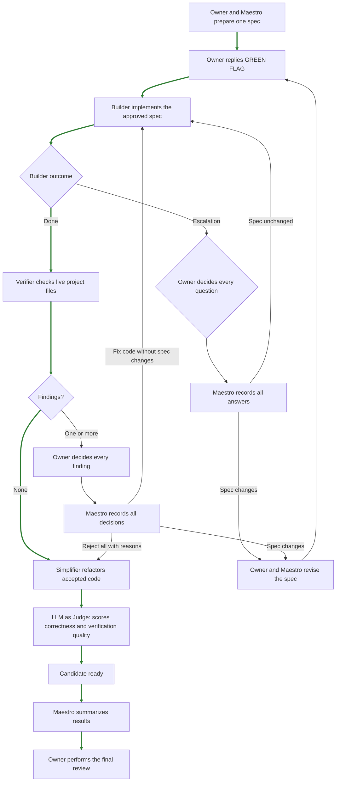

# Workflow

## Main flow

The diagram shows a flow with all three agents and scoring enabled. The green arrows and lines show the path without `escalations` or `findings`.



## Workflow phases

The saved phase in `workflow.json` determines what can happen next.

| Phase                  | Meaning                                                                                                                       |
| ---------------------- | ----------------------------------------------------------------------------------------------------------------------------- |
| `drafting-spec`        | The `owner` and `Maestro` prepare the initial `spec` or revise it after recorded `escalation` answers or `finding` decisions. |
| `ready-for-builder`    | The approved `spec` or recorded `owner` decisions permit a `builder` `run`.                                                   |
| `builder-running`      | A `builder` `run` is active.                                                                                                  |
| `escalation-decisions` | The `owner` must decide how to handle every `escalation` question.                                                            |
| `ready-for-verifier`   | The `builder` completed the work and the `verifier` can start.                                                                |
| `verifier-running`     | A `verifier` `run` is active.                                                                                                 |
| `finding-decisions`    | The `owner` must decide how to handle every current `finding`.                                                                |
| `simplifier-running`   | Selected preceding phases finished. The enabled `simplifier` can run or skip if Git is unavailable.                           |
| `scorer-running`       | Implementation is finished. Evaluation gathers evidence and saves scores or a failure before completion.                      |
| `candidate-ready`      | The workflow is complete; the `owner` can review its results.                                                                 |

## Specification documents

Each new `spec` uses these documents in the same directory:

| Document      | Content                                                                                                      | Presence                                                       |
| ------------- | ------------------------------------------------------------------------------------------------------------ | -------------------------------------------------------------- |
| `proposal.md` | Problem, goal, scope, and exclusions.                                                                        | Always created.                                                |
| `spec.md`     | Required behavior, constraints, deltas, `acceptance criteria` next to their requirements, and `assumptions`. | Always created.                                                |
| `design.md`   | Approved technical decisions, brief reasons, relevant contracts, risks, and prototype references.            | Only when significant technical decisions need to be recorded. |

## Spec approval

Review `proposal.md`, `spec.md`, and `design.md` if present. Reply `GREEN FLAG` when `Maestro` asks for approval. This approves the whole set, including any visual
prototypes, and starts the selected [implementation phases](configuration.md#phase-selection). The approved files are frozen until a [spec revision](#spec-revision).

## Escalations

The `builder` raises an `escalation` when an implementation question or blocker needs an `owner` decision. The `owner` gives `Maestro` an answer and a reason for each
question and can pick a suggested option or give a different answer. References such as [B1/E1](glossary.md#identifiers-and-file-names) identify the question in its
report.

| `Owner` choice          | Result                                                                                                                            |
| ----------------------- | --------------------------------------------------------------------------------------------------------------------------------- |
| Keep the current `spec` | `Maestro` starts another `builder` `run` without renewed approval.                                                                |
| Change the `spec`       | The `owner` and `Maestro` revise the same `spec`. The `owner` reviews it and replies `GREEN FLAG` before another `builder` `run`. |

## Findings

A `finding` is an issue the `verifier` identifies while independently checking the implementation against the approved `spec`. The `owner` decides how to handle each
`finding`, regardless of severity. References such as [V1/F2](glossary.md#identifiers-and-file-names) identify the issue in its report.

| Decision      | Result                                                                                                                                                                                      |
| ------------- | ------------------------------------------------------------------------------------------------------------------------------------------------------------------------------------------- |
| `reject`      | Records the owner's reason. If every `finding` is rejected, the workflow reaches `simplifier-running` when enabled, otherwise `scorer-running` if scoring is enabled, or `candidate-ready`. |
| `fix-code`    | Keeps the current `spec` and returns to `ready-for-builder` for code fixes when no decision requires revision.                                                                              |
| `revise-spec` | Records the owner's reason and agreed requirement change, then returns to `drafting-spec`.                                                                                                  |

If any `finding` requires revision, revise the `spec` before any code fixes. Otherwise, if any decision is `fix-code`, the `verifier` checks the work again after the
`builder` fixes it. Rejecting a `finding` does not mean its check passed.

## Spec revision

A decision to change the `spec` pauses implementation. Review the revised document set and reply `GREEN FLAG` again before the `builder` restarts. Earlier reports and
decisions remain available as context.

## Verification boundary

The `verifier` can make temporary changes to run its checks. Before submitting its `handoff`, it restores the exact original contents of affected files and removes only
files it created.

Cleanup relies on the `verifier`. If cleanup cannot finish safely, the `verifier` stops and reports the remaining changes.

## Simplification

When enabled, `Maestro` starts the `simplifier` after successful verification, rejection of all `findings`, or `builder` completion with verification disabled. The
`simplifier` runs only if Git is available, if not, a warning is displayed: `Simplifier skipped: Git repository unavailable.`

The `simplifier` starts from all staged, unstaged, and untracked code changes, including pre-existing changes. It preserves observable behavior and introduces no new
check failures. If no code needs refactoring, the `simplifier` does not make any change.

## Workflow evaluation

When scoring is enabled, `scorer-running` evaluates the entire workflow against the approved `spec` after the selected implementation phases, including simplification.
The selected Pi classifier receives the approved documents, available `handoffs` and `owner` decisions, and staged, unstaged, and untracked Git changes against `HEAD`.
Scoring is off by default. The `owner` can choose a classifier in [Agent models](configuration.md#agent-models) before starting or restarting a `spec`.

The classifier's ratings are converted to two separate scores on a **0–100 scale**. Each retains its confidence value from 0 to 1:

| Score                | Criteria                                                                                                                                                                 |
| -------------------- | ------------------------------------------------------------------------------------------------------------------------------------------------------------------------ |
| Correctness          | How fully the implementation meets the approved requirements: from missing or fundamentally wrong behavior to all required behavior supported with no identified defect. |
| Verification quality | How well execution or code inspection supports the required scenarios: from unsupported claims to complete, traceable evidence, including relevant failure cases.        |

Missing verification evidence is not a code defect. Checks run by the `Builder` can support the evaluation, but they are not independent verification.

The automatic grading helps the `owner` decide how much to trust the workflow's outcome. It does not prove the work is correct.

Results are saved in the `spec-score/` folder inside the active `spec` directory:

- `evaluation.json` has the scores and confidence values, or the reason for a failure.
- `evaluation.raw.json` has the classifier response, if one was returned.

Evaluation needs Git with an existing `HEAD`. Once a success or a failure is saved, the workflow moves to `candidate-ready`. If the evaluation hits an error or is
cancelled, a failure report is saved without scores. If the report cannot be saved, the workflow cannot finish. Maestro adds the workflow evaluation in the final summary.

## Workflow completion

When the workflow ends, `Maestro` presents a summary and turns off. The `owner` then reviews the changes.

## Stored artifacts

A new `spec` starts with `proposal.md`, `spec.md`, `workflow.json`, and an empty `prototypes/` directory. `design.md` is optional, and `handoff` directories appear when
the first reports are saved. This example shows the files saved when all phases are enabled and the `verifier` checks the code again after a fix.

```text
.specs/<spec-id>/
├── proposal.md
├── spec.md
├── design.md
├── workflow.json
├── handoffs/
│   ├── builder/
│   │   ├── B1.json
│   │   └── B2.json
│   ├── verifier/
│   │   ├── V1.json
│   │   └── V2.json
│   └── simplifier/
│       └── S.json
├── spec-score/
│   ├── evaluation.json
│   └── evaluation.raw.json
└── prototypes/
```

| What happens                                             | Report saved or updated |
| -------------------------------------------------------- | ----------------------- |
| The `builder` implements the change.                     | Creates `B1.json`.      |
| The `verifier` checks the change and reports `findings`. | Creates `V1.json`.      |
| The `owner` requests a code fix for `V1/F2`.             | Updates `V1.json`.      |
| The `builder` fixes the issue.                           | Creates `B2.json`.      |
| The `verifier` checks the fix.                           | Creates `V2.json`.      |

`B` and `V` are numbered separately within each `spec`. Revising the `spec` does not reset the numbering or remove earlier reports.

## Limitations

### No small models

The `owner` must not use small models with a `low` thinking level for this workflow. These combinations cannot reliably follow the workflow rules. One example is
`gpt-luna-6` with `thinking: "low"`.

Moreover, the workflow works well with a defined harness: tests, lint for code rules, anti-slop checks for unwanted patterns, and `AGENTS.md`. `Maestro` does not supply
these project-specific checks.

### No automatic rollback

A failed or interrupted `run` can leave file changes on disk and a running phase in `workflow.json`. `Maestro` does not roll back or repair partial changes. The `owner`
should inspect the project files and saved reports before restarting.

### Restart an existing spec

To revisit an existing `spec`, choose "Restart spec" in `/maestro`. The selected `spec` returns to `drafting-spec` from any saved phase. `Maestro` reads and reviews its
proposal, `spec`, and optional design with the `owner` before asking for renewed `GREEN FLAG`.

Restart preserves the existing files except for the workflow phase. Saved `owner` decisions retain their normal effect for the same approved documents. Restart does not
recover an interrupted agent or its conversation, reconstruct progress from the previous phase, or reconcile partial saves.
